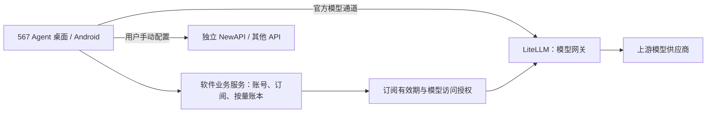

# 567 Agent 2.0：LiteLLM 后端可行性评估

评估日期：2026-10-13。依据当前客户端源码、LiteLLM 官方文档和用户确认的产品方向。当前发布批仍为 1.x；以下是 2.0 迁移方案，没有部署或切换生产服务。

## 结论与边界

可行，适合把模型接入、虚拟密钥、路由、限流和成本观测交给 LiteLLM。它提供兼容 OpenAI 的网关接口，能够承接当前客户端的大部分模型请求。[官方网关说明](https://docs.litellm.ai/docs/simple_proxy)

已确认的产品方向：现有 NewAPI 继续正常运营，独立提供 API 网关服务；2.0 软件的官方模型通道只接入 LiteLLM，支持分档订阅和按量付费。用户可以在自定义供应商中手动添加其他 API，包括现有 567 API 的 NewAPI。软件不再自动登录 NewAPI、同步其余额与分组或签发该网关的模型令牌。

软件需要独立的业务服务，负责软件账号、订阅订单、有效期、套餐权益、按量付费账本与 LiteLLM 访问授权。客户端把业务地址和官方模型网关地址拆开。NewAPI 的账户、充值与余额归其独立网关管理，不自动转换为软件订阅或 LiteLLM 用量。

远程连接中继、本机 Agent、会话与文件存储、MCP 和 Skills 的执行仍由现有客户端负责。后端迁移的验收重点是模型请求与业务账号接口；没有必要同时迁移这些本机功能。

## 已确认的使用与计费规则

- 自定义供应商由用户自行配置与承担费用。软件不参与其收费、扣除官方套餐额度，或套用官方套餐的模型和速率限制；供应商自身的鉴权、收费和限速照常生效。
- 官方订阅按档位分别规定额度、限速和可用模型范围，同时支持 LiteLLM 官方通道按量付费。
- 订阅额度耗尽后，只有用户预先开启自动兜底才转为按量付费。开关默认关闭；未开启时停止官方请求并提示额度不足，不能无提示收费。

## 尚待确定的具体规则

- 套餐档位的额度单位、重置周期、具体速率和并发数、模型范围与生图配额。
- 按量价格、余额充值与结算方式、兜底消费上限。自动兜底只覆盖额度耗尽，不能默认为用户解锁套餐之外的模型或提高限速；这两项需要另行明确。
- 旧 NewAPI 用户是否有软件订阅优惠或兑换方案。这属于独立商业规则，不能把旧 API 余额擅自迁移或扣除。

建议订阅到期后仍允许查看和导出本地会话与文件。服务端执行订阅到期、退款、额度耗尽和密钥撤销的规则，不能只靠客户端隐藏按钮限制官方模型调用。

## 订阅与按量切换的实现要求

| 请求条件 | 执行与结算 |
| --- | --- |
| 用户选择自定义供应商 | 直接使用该供应商配置；官方订阅和按量账本不扣费 |
| 官方订阅有效且有额度 | 校验该档位的模型和限速；预留并核销订阅额度 |
| 官方订阅额度不足，未开启兜底 | 停止请求并提示；不自动发起按量收费 |
| 官方订阅额度不足，已开启兜底 | 校验按量付费授权、可用余额及消费限制后执行，记录本次计费来源 |
| 用户主动选择按量模式 | 使用按量通道允许的模型和限速，按明确的价格结算 |

LiteLLM 提供虚拟密钥、预算和速率限制，适合执行模型访问和网关限制；严格的套餐核销、充值订单及自动兜底状态仍由软件业务服务持有。预算需要数据库支持，不能用无数据库部署承担收费额度限制。[预算与限速文档](https://docs.litellm.ai/docs/proxy/users)

一个逻辑请求必须使用唯一 ID 关联预留、实际模型调用、取消、重试和结算。订阅与按量账本不能分别收到同一请求的全额扣费；正在执行的请求也不能因并发额度耗尽再提交一遍上游调用。兜底切换由服务端执行并留下记录，客户端明确展示当前使用的计费模式和余额，用户可随时关闭兜底。

## 双端界面与数据迁移要求

- 官方账号页展示订阅档位、有效期、剩余额度和限速，以及独立的按量付费状态；取消目前自动读取 NewAPI 余额和分组的流程。
- 模型配置分为官方 LiteLLM 模型和用户自定义 API 供应商。桌面与 Android 都需要能填写服务地址、API Key 和模型配置；“本地”表示用户自定义连接，不代表模型在设备上运行。
- 自动按量兜底提供显式开关，默认关闭；打开前显示价格规则。建议允许设置消费上限，在模型选择和实际请求结果中显示本次使用订阅额度还是按量结算，防止切换不透明。
- 自定义供应商的密钥由用户管理，官方登录、注销和订阅过期不能误删它，也不能让官方密钥与自定义密钥交叉使用。
- 用户会话、项目、图片、附件、工具记录与自行配置的供应商继续保留；新版本不把会话历史当作账号或余额迁移数据。
- NewAPI 原有账号、令牌和余额继续存在于独立网关。旧的应用托管配置改为一次性迁移提示，由用户选择是否手动保留为自定义供应商；不自动发起请求，不自动转换余额。
- 旧会话继续打开时，用户可以选择 LiteLLM 官方模型或自行保留的旧供应商续聊，明确显示当前通道，不能偷偷换模型或承担额外费用。

本方案由本会话维护；当前 1.x 的构建、标签及发布修复交由其他代理负责。

## 当前代码的耦合点

| 位置 | 已核实的当前行为 | 2.0 需要处理 |
| --- | --- | --- |
| `apps/desktop/src/main/567api/newapi-service.ts` | 固定业务地址及 `/v1` 地址；调用 NewAPI 注册、登录、刷新、用户、分组、令牌、充值接口 | 2.0 官方通道移除该自动接入链路，替换为独立订阅服务及 LiteLLM；NewAPI 仅通过用户自定义供应商接入 |
| `apps/mobile/shared/src/commonMain/kotlin/org/agent567/android/core/api/Agent567Api.kt` | 同时承担 NewAPI 账号请求、模型列表、聊天和生图 | 与桌面共用接口合同，避免两端分别猜测新后端语义 |
| `apps/mobile/shared/src/commonMain/kotlin/org/agent567/android/core/Agent567Config.kt` | 从一个服务地址派生账号和模型端点 | 业务地址与模型地址分开配置，升级时显式迁移 |
| `apps/mobile/shared/src/commonMain/kotlin/org/agent567/android/core/net/SecurityHeaders.kt` | 发送 `X-567-*` 设备及签名头 | 在业务 API 或网关入口明确校验策略；不能假定 LiteLLM 会自动执行旧鉴权 |
| 桌面托管供应商与手机分组选择 | 当前分组名、供应商 ID 和部分模型行为带有 NewAPI 约定 | 官方目录改为订阅允许的 LiteLLM 模型；旧历史引用保持可读，续聊时明确选择新通道 |
| `apps/desktop/src/renderer/domains/settings/components/useModelsSettingsModel.ts` | 当前通过供应商 ID、显示名称及 `api.567.wiki` 地址隐藏条目 | 改为只识别应用托管条目；用户手动添加的同域名、同品牌供应商必须可见、可编辑和可使用 |

## 最可能出现的问题

### 1. 软件订阅账号与独立网关账号需要分开

软件订阅会话、LiteLLM 模型访问密钥和用户自行填写的 API 密钥必须分别存储和撤销。LiteLLM 的虚拟密钥用于授权模型请求，模型范围与额度可限制；创建密钥的管理凭证应只留在服务器，不能放进安装包。[虚拟密钥文档](https://docs.litellm.ai/docs/proxy/virtual_keys)

需要定义独立的软件账号登录、刷新、订阅购买、支付回调、续期、退款和密钥撤销协议。NewAPI 原有用户和余额继续留在原服务。若提供账号关联或订阅优惠，另行定义经过用户确认的兑换方案，不能把旧账号 Token 当作软件订阅凭证。

升级到 2.0 时保留历史会话与用户自行创建的供应商配置；对旧的应用托管 NewAPI 凭证提示用户是否愿意手动保留为自定义供应商，不自动启用或发送请求。官方默认模型改为订阅目录中的 LiteLLM 模型，历史消息里的模型引用不强制改写。

### 2. 订阅权益与模型消耗要采用独立合同

LiteLLM 的费用记录与回调在响应返回后异步执行。由此推断：若订阅包含严格的用量额度，单纯把异步 spend 当作实时剩余额度会在并发请求或进程退出时产生短暂不一致；需要定义请求唯一 ID、额度预留与释放、最终核销和对账。[请求生命周期](https://docs.litellm.ai/docs/proxy/architecture)

软件界面显示订阅状态、到期时间与套餐权益；用量展示根据最终确定的订阅规则实现，独立 NewAPI 的余额不再自动显示为软件余额。自定义模型需要配置价格；上游没有返回完整 usage 时，成本不能凭空变得精确。区分模型实际 usage、估算 Token、订阅权益核销和后台成本，不把后台采购成本当作用户需额外充值的金额。[成本追踪文档](https://docs.litellm.ai/docs/proxy/cost_tracking)

### 3. 生图需要逐模型验证，重试策略需要单独设置

官方支持图片生成与编辑，但端点、参考图数量、响应格式和尺寸参数随供应商变化。当前通过聊天接口返回图片的模型、网页转接生图模型与标准 `/images/generations` 不能只根据名称合并处理。优先用明确能力元数据选择路径，继续把生成结果保存为本地文件。[图片生成](https://docs.litellm.ai/docs/image_generation)、[图片编辑](https://docs.litellm.ai/docs/image_edits)

网关有重试和故障转移，客户端也可能重试。上线前应明确谁拥有重试策略；收费生图在没有上游幂等保证时不应因超时自动重复提交，防止重复收费。取消后仍可能存在上游已经计费的任务，要向用户显示真实结果。[路由与重试](https://docs.litellm.ai/docs/routing)

对尚未被标准适配器支持的专用端点，可以评估透传或自定义适配器，同时核实鉴权、错误、取消和计费合同。[透传端点](https://docs.litellm.ai/docs/proxy/pass_through)

### 4. SSE、工具调用与模型能力仍需要端到端验证

兼容 OpenAI 的接口能减少改造量，但不保证所有上游的事件细节相同。需要使用真实目标渠道验证工具参数分片、思考内容、工具执行循环、空正文、终态与 usage 的先后顺序，以及取消传播。客户端现有 SSE 截断防护和会话隔离继续保留。

模型目录应明确列出上下文长度、是否支持图片输入、工具、结构化输出、推理参数、图片生成及编辑端点。网关模型别名与上游模型 ID 分开记录，避免切换供应商时误报价格或能力。usage 的含义和细项也应按供应商核对。[Usage 文档](https://docs.litellm.ai/docs/completion/usage)

手机本地图片路径对服务器不可访问。上传、文件读取及安全限制需要沿用客户端现有机制；不能把本地路径直接交给云端模型。普通文件也不能在未验证支持的情况下当作图片输入。

### 5. 运维与许可要提前确定

初期可从固定版本 Docker 部署与 PostgreSQL 开始；多实例时再按文档加入 Redis。升级数据库迁移只运行一次，版本固定并做回退演练。数据库、配置和用于加密供应商凭证的 `LITELLM_SALT_KEY` 需要一起备份；现有加密数据不能随意更换该密钥。[部署说明](https://docs.litellm.ai/docs/proxy/deploy)

核心能力与企业功能的边界需要按选定版本核实，尤其是 SSO、审计、组织权限等需求，不能因为存在管理界面就假定全部免费。管理界面限制管理员访问，默认日志避免保存完整聊天、附件和密钥。[企业功能说明](https://docs.litellm.ai/docs/enterprise)

## 推荐实施顺序与验收

1. 建立隔离的 LiteLLM 环境，固定版本；选定聊天、工具、视觉和生图渠道。用测试密钥验证流式输出、usage、错误码和取消，不切换生产流量。
2. 确定订阅权益规则，定义独立订阅业务 API、模型目录及受限虚拟密钥合同。把客户端两种地址拆开；NewAPI 继续独立运营，旧 1.x 客户端的兼容期限另行安排。
3. 双端接入同一合同。覆盖登录刷新与注销、订阅到期与退款、模型选择、第一轮与多轮工具调用、图片附件、生成及编辑、重试和取消，确认不会重复请求或核销权益。
4. 验证本地数据升级、历史会话续聊、自定义供应商配置，以及用户手动添加现有 567 API 的完整流程；确保没有因域名或品牌名称被隐藏。NewAPI 账号和余额仍归独立网关，不自动转成订阅。
5. 对照并发请求、上游失败、网关重启和断网测试权益限制、后台成本、日志与 UI；验收后再安排 2.0 发布和逐步切流。

本轮只核对了客户端依赖和官方能力文档。尚未进行目标渠道的真实付费 API 验证、服务端数据库迁移或生产部署，这些是 2.0 实施阶段的验收项。
