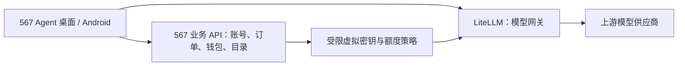

# 567 Agent 2.0：LiteLLM 后端可行性评估

评估日期：2026-10-13。依据当前客户端源码和 LiteLLM 官方文档。这里记录候选方案；本轮实现继续属于 1.x，没有部署或切换生产服务。

## 结论与边界

可行，适合把模型接入、虚拟密钥、路由、限流和成本观测交给 LiteLLM。它提供兼容 OpenAI 的网关接口，能够承接当前客户端的大部分模型请求。[官方网关说明](https://docs.litellm.ai/docs/simple_proxy)

结合当前代码，推荐保留独立的 567 业务 API，负责用户账号、充值订单、钱包、套餐与模型目录授权；LiteLLM 负责向上游模型发请求。客户端把业务地址和模型网关地址拆开，避免再次把两个服务绑定到一个固定地址。这个职责划分是对本项目需求的设计建议，不是已经完成的迁移。

远程连接中继、本机 Agent、会话与文件存储、MCP 和 Skills 的执行仍由现有客户端负责。后端迁移的验收重点是模型请求与业务账号接口；没有必要同时迁移这些本机功能。

## 当前代码的耦合点

| 位置 | 已核实的当前行为 | 2.0 需要处理 |
| --- | --- | --- |
| `apps/desktop/src/main/567api/newapi-service.ts` | 固定业务地址及 `/v1` 地址；调用 NewAPI 注册、登录、刷新、用户、分组、令牌、充值接口 | 拆分账号服务与模型网关；增加业务协议适配，保留旧账号迁移入口 |
| `apps/mobile/shared/src/commonMain/kotlin/org/agent567/android/core/api/Agent567Api.kt` | 同时承担 NewAPI 账号请求、模型列表、聊天和生图 | 与桌面共用接口合同，避免两端分别猜测新后端语义 |
| `apps/mobile/shared/src/commonMain/kotlin/org/agent567/android/core/Agent567Config.kt` | 从一个服务地址派生账号和模型端点 | 业务地址与模型地址分开配置，升级时显式迁移 |
| `apps/mobile/shared/src/commonMain/kotlin/org/agent567/android/core/net/SecurityHeaders.kt` | 发送 `X-567-*` 设备及签名头 | 在业务 API 或网关入口明确校验策略；不能假定 LiteLLM 会自动执行旧鉴权 |
| 桌面托管供应商与手机分组选择 | 当前分组名、供应商 ID 和部分模型行为带有 NewAPI 约定 | 保留旧 ID 的映射，新增明确的模型能力与端点元数据 |

## 最可能出现的问题

### 1. 账号、余额与支付不能只靠换 URL 迁移

当前登录凭证、模型令牌和用户余额不是同一种对象。LiteLLM 的虚拟密钥用于授权模型请求，模型范围与额度可限制；创建密钥的管理凭证应只留在服务器，不能放进安装包。[虚拟密钥文档](https://docs.litellm.ai/docs/proxy/virtual_keys)

本项目需要单独定义账号登录和刷新协议、旧用户映射、钱包金额单位、支付回调、退款及密钥撤销。密码哈希能否保留取决于旧服务和新业务 API 的算法兼容性；未确认前不能承诺无感迁移。历史会话里保存的供应商与模型引用应保留映射，用户自定义供应商继续可用。

### 2. 成本观测不等于充值钱包的最终结算

LiteLLM 的费用记录与回调在响应返回后异步执行。由此推断：如果直接把查询到的 spend 当作实时钱包余额，并发请求或进程退出可能出现短暂不一致；需要在 567 业务层设计请求唯一 ID、额度预留、最终结算和对账。[请求生命周期](https://docs.litellm.ai/docs/proxy/architecture)

现有分组倍率和充值余额单位也要明确换算。自定义模型需要配置价格；上游没有返回完整 usage 时，成本不能凭空变得精确。界面应区别上游实际 usage、估算 Token 和用户最终扣费。[成本追踪文档](https://docs.litellm.ai/docs/proxy/cost_tracking)

### 3. 生图需要逐模型验证，重试策略需要单独设置

官方支持图片生成与编辑，但端点、参考图数量、响应格式和尺寸参数随供应商变化。当前通过聊天接口返回图片的模型、网页转接生图模型与标准 `/images/generations` 不能只根据名称合并处理。优先用明确能力元数据选择路径，继续把生成结果保存为本地文件。[图片生成](https://docs.litellm.ai/docs/image_generation)、[图片编辑](https://docs.litellm.ai/docs/image_edits)

网关有重试和故障转移，客户端也可能重试。上线前应明确谁拥有重试策略；收费生图在没有上游幂等保证时不应因超时自动重复提交，防止重复收费。取消后仍可能存在上游已经计费的任务，要向用户显示真实结果。[路由与重试](https://docs.litellm.ai/docs/routing)

对尚未被标准适配器支持的专用端点，可以评估透传或自定义适配器，同时核实鉴权、错误、取消和计费合同。[透传端点](https://docs.litellm.ai/docs/proxy/pass_through)

### 4. SSE、工具调用与模型能力仍需要端到端验证

兼容 OpenAI 的接口能减少改造量，但不保证所有上游的事件细节相同。需要使用真实目标渠道验证工具参数分片、思考内容、工具执行循环、空正文、终态与 usage 的先后顺序，以及取消传播。客户端现有 SSE 截断防护和会话隔离继续保留。

模型目录应明确列出上下文长度、是否支持图片输入、工具、结构化输出、推理参数、图片生成及编辑端点。网关模型别名与上游模型 ID 分开记录，避免切换供应商时误报价格或能力。usage 的含义和细项也应按供应商核对。[Usage 文档](https://docs.litellm.ai/docs/completion/usage)

手机本地图片路径对服务器不可访问。上传、文件读取及安全限制需要沿用客户端现有机制；不能把本地路径直接交给云端模型。普通文件也不能在未验证支持的情况下当作图片输入。

### 5. 运维与许可要提前确定

初期可从固定版本 Docker 部署与 PostgreSQL 开始；多实例时再按文档加入 Redis。升级数据库迁移只运行一次，版本固定并做回退演练。数据库、配置和用于加密供应商凭证的 `LITELLM_SALT_KEY` 需要一起备份；现有加密数据不能随意更换该密钥。[部署说明](https://docs.litellm.ai/docs/proxy/deploy)

核心能力与企业功能的边界需要按选定版本核实，尤其是 SSO、审计、组织权限等需求，不能因为存在管理界面就假定全部免费。管理界面限制管理员访问，默认日志避免保存完整聊天、附件和密钥。[企业功能说明](https://docs.litellm.ai/docs/enterprise)

## 推荐实施顺序与验收

1. 建立隔离的 LiteLLM 环境，固定版本；选定聊天、工具、视觉和生图渠道。用测试密钥验证流式输出、usage、错误码和取消，不切换生产流量。
2. 定义独立业务 API 与模型目录合同，形成账号、钱包和受限虚拟密钥的服务端方案。把客户端两种地址拆开，保持旧 1.x 路由可用。
3. 双端接入同一合同。覆盖登录刷新与注销、模型选择、第一轮与多轮工具调用、图片附件、生成及编辑、重试和取消，确认不会重复请求或扣费。
4. 对旧用户和余额做迁移演练与双向对账，验证历史会话仍可打开和续聊。保留原服务及恢复路径，先向小范围用户开放。
5. 对照并发请求、上游失败、网关重启和断网测试最终账单、日志与 UI；验收后再安排 2.0 发布和逐步切流。

本轮只核对了客户端依赖和官方能力文档。尚未进行目标渠道的真实付费 API 验证、服务端数据库迁移或生产部署，这些是 2.0 实施阶段的验收项。
